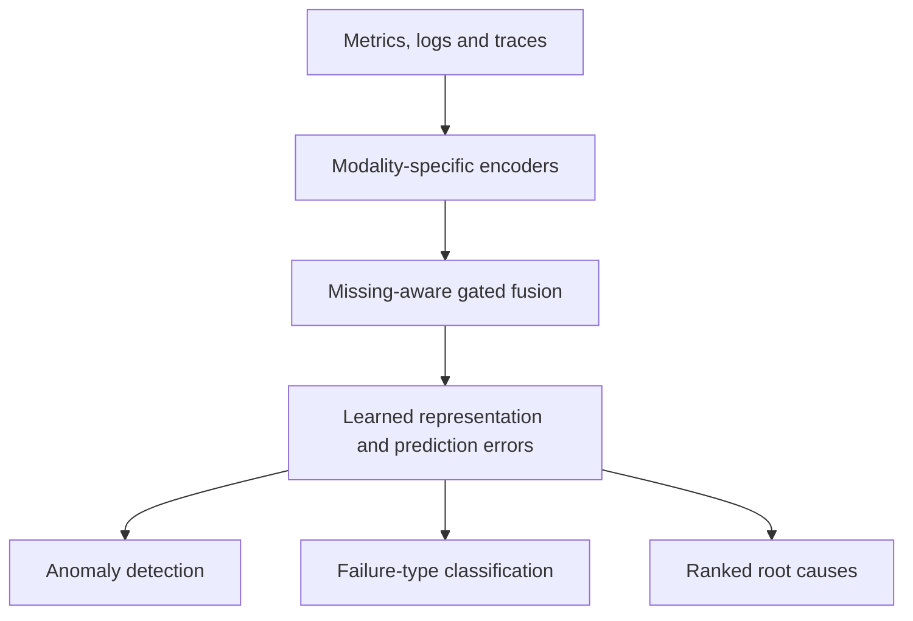

# ARMOR baseline — Workbook 2 handoff

Prepared for Bhoomika, 11 November 2026. Methodology and progress summary for Sections 3 and 4; map the headings to the workbook template. The actual template was not provided in this turn. Team review is required before submission.

## 1. Baseline and selection rationale

We selected ARMOR as the published comparison method for our incident-management project. It addresses anomaly detection, failure-type classification and root-cause localization using metrics, logs and traces. Its missing-modality focus is relevant when monitoring data is incomplete. Released code, D1 data, checkpoints and predictions provide a practical basis for reproducibility checks. This is the rationale for its suitability; it does not claim our proposed system outperforms ARMOR. [1–3]

## 2. Architecture

ARMOR uses modality-specific asymmetric encoders, followed by missing-aware gated fusion with learnable placeholders and bias compensation. Self-supervised autoregression with mask-guided reconstruction learns normal behavior. The resulting representation supports three diagnostic tasks: anomaly detection (AD), failure triage (FT), and root-cause localization (RCL). AD and RCL do not require fault labels; FT uses failure-type annotations for a downstream classifier. [1]

In the released implementation, the FT classifier uses XGBoost. Anomaly scoring and thresholding, fault classification and ranked root-cause outputs should be described as separate tasks; fault-type evaluation uses known incident times rather than proving an end-to-end detection-and-classification system. [3]

### Suggested conceptual diagram

Figure caption: Conceptual summary of ARMOR's diagnostic architecture, adapted from the method description in [1]. This is not our Model 1 Transformer architecture or a deployment diagram.

## 3. Dataset and preprocessing

We use the official ARMOR D1 release from Zenodo record 21744694. D1 originates from the ART dataset. The reproduction downloads D1 and the required official code/artifacts; D2 is excluded. The acquisition scripts verify release metadata, archive-member sizes/CRCs and nested archive integrity and record hashes. The complete outer-archive MD5 is not recomputed because the archive also includes D2. [2–4]

| Item | D1 detail |
|---|---|
| Total released samples | 7,200 at one-minute timestamps |
| Released normal-training pool | 3,714 samples |
| Released failure-associated sample pool | 3,486 samples |
| Per-sample structure | Timestamp, DGL graph, float32 feature matrix |
| Matrix dimensions | 46 nodes × 130 channels |
| Modalities | 110 metric, 9 trace and 11 log-derived channels |
| Incident case records | 210 |
| Failure labels | 15 fine-grained types mapped to five categories |
| FT/RCL case split | First 126 cases for training; final 84 for evaluation |
| Official post-cutoff AD labels | 98 |

The release contains precomputed numerical features, not raw log lines or trace spans. Feature ordering and graph/node mappings come from the official files. We retain the baseline's original input processing, configuration and task-specific splits. We do not apply Model 1's 88/13/25/84 partition to ARMOR. [3–4]

The 3,714/3,486 sample pools are not a conventional chronological train/test split. The released normal pool includes normal telemetry after the evaluation cutoff. For faithful reproduction we preserve that behavior and disclose it. The exact upstream feature-normalization recipe is unknown; the repository audit reports evidence suggesting normalization across the released timeline. Natural zero values must not all be interpreted as missing data. Injection timestamps are available, but incident end times are not. The AD-label file and case records differ, so their evaluation populations must remain distinct. [4]

## 4. Technology stack and execution

Nikhil configured Google Colab with a Tesla T4 GPU and a separate Python 3.9.23 environment. The current stack is PyTorch 1.12.1+cu113, DGL 0.9.0 (CUDA 11.3 build), CUDA runtime 11.3.1, XGBoost 1.7.6, NumPy 1.23.5, SciPy 1.9.3, pandas 1.5.3 and scikit-learn 1.1.2. Micromamba manages the isolated environment. Matplotlib uses the noninteractive Agg backend for subprocess execution. [5]

PyTorch/DGL CUDA graph operations passed on the T4. XGBoost import, synthetic training and prediction passed. Its installed wheel contains Python 3.10 metadata tags in the Python 3.9 environment; this specific pip compatibility warning is documented rather than hidden or represented as a clean pip check. Full experiment validity still depends on completion and output verification. [5]

The Colab workflow pins repository commit `b133b5d786043c67b2c8d0996a336b567e232cb5`, separates released-checkpoint evaluation from independent training, and directs logs/results to Google Drive. Independent training starts with no released checkpoint in its run directory. The official model configuration is preserved. Drive persistence does not establish that interrupted training can resume. [3,5]

## 5. Evaluation plan

| Task | Measures and interpretation |
|---|---|
| Anomaly detection | Precision, recall and F1 using ARMOR's official interval-matching implementation; 98 post-cutoff AD labels. Include false-positive interval counts and alert coverage when available. |
| Failure-type classification | Weighted precision, recall and F1 on 84 held-out cases. Macro-F1 and accuracy can be supplementary measures, clearly labelled. |
| Root-cause localization | Top@1 through Top@5 and Avg@5 on the official held-out cases. |
| Reproducibility | Record code revision, environment, configuration, logs, runtime and output/checkpoint hashes. Compare generated outputs using the repository scoring scripts. |

Reproduction is tracked at three levels: A, rescoring authors' predictions; B, evaluating the released checkpoint; C, training independently. Existing repository evidence reports Tier A agreement with published numbers and Tier B agreement for AD/RCL, but an unresolved FT discrepancy. These are prior repository results, not Nikhil's completed independent-training results. [3]

For context only, the documented released-prediction targets are AD F1 0.9608, FT weighted F1 0.938 and RCL Avg@5 0.9095. Do not place these in a column labelled “our independently reproduced result.” Current independent results remain pending. [3]

## 6. Verified progress and contributions

### Nikhil Kanaparthi — first-person contribution statement

I configured the ARMOR reproduction environment on a Colab Tesla T4 and resolved DGL download/CUDA-runtime and Matplotlib backend issues. I verified PyTorch/DGL GPU execution and XGBoost's basic training functionality, while documenting the package-metadata warning. I completed released-checkpoint evaluation, verified the comparison report against my prediction file, and identified two additional fault-type errors relative to the released predictions. I also completed a two-epoch training probe and started independent ARMOR D1 training from scratch using the released configuration. I am recording execution logs and reproduction evidence in Drive and preparing the dataset, environment and methodology handoff for Workbook 2.

The probe completed two epochs in 218.4 seconds (approximately 109.2 seconds per epoch). In the latest shared full-run log, 9 of a maximum 1,000 epochs had completed in approximately 15 minutes 47 seconds. The initial printed loss was 0.1781759435. This shows training progress, not final diagnostic accuracy. Early stopping may terminate the run before the maximum; completion time is not guaranteed. [5]

Run ID: `colab_from_scratch_20261111T202210Z_73bdda`.

Current reportable status: **Independent baseline training in progress; final evaluation and results pending.** Successful GPU library tests do not by themselves measure GPU utilization throughout training. Nikhil's Tier B comparison and fault predictions have now been supplied and checked; the verified checkpoint results are recorded below. No completed Tier C results have been supplied.

### Attribution for other team members

- Khushi: the existing repository baseline reproduction guide/scripts/evidence predate this Colab run; cite them as existing team work.
- Akhilesh and Saketh: ask each to provide the exact completed contribution and evidence. No individual completed task is asserted here on their behalf.
- Bhoomika's Model 1/Airflow/BigQuery/deployment work is a separate workstream. The team message reports that work; it has not been independently audited in this handoff.

## 7. Evidence for today's workbook/PPT

Available in this PR: the checkpoint comparison JSON and the verified results and case analysis below. The Colab notebook, setup/GPU checks, dependency records, timing probe and training progress were shared separately; the complete exported execution bundle remains pending.

Pending: final Tier C metric JSON, completed-run status, generated-output hashes and conclusions about independent reproduction. Do not wait for those to write the methodology section. Do not commit raw datasets or model pickle/checkpoint files to the public repository.

## 8. Verified Colab checkpoint results — 11 November 2026

Run: `colab_released_20261111T202210Z_73bdda`. Evidence: [tierB_comparison.json](evidence/nikhil_colab_20261111/tierB_comparison.json).

| Evaluation | AD F1 (98 labels) | FT weighted F1 (84 cases) | RCL Avg@5 (84 cases) |
|---|---:|---:|---:|
| Published / released-prediction target | 0.9608 | 0.9380 | 0.9095 |
| Prior team CPU checkpoint, XGBoost 1.6.2 / 1.7.6 [3] | 0.9608 | 0.8840 | 0.9095 |
| Prior team CPU checkpoint, XGBoost 2.0.3 / 2.1.4 [3] | 0.9608 | 0.8968 | 0.9095 |
| Nikhil Colab checkpoint, XGBoost 1.7.6 | 0.9608 | 0.9075 | 0.9095 |
| Nikhil independent training | Pending | Pending | Pending |

The Colab report records identical AD intervals and identical node ordering in all RCL rankings; the maximum absolute RCL score difference is 4.353827606773386e-08. Matching rounded metrics is not a claim of byte-identical floating-point outputs. AD precision/recall are 0.9245/1.0000. FT weighted precision/recall are 0.9223/0.9167, accuracy is 77/84 (0.916667), and macro-F1 is 0.815825. RCL Top@1–5 are 0.8214, 0.8929, 0.9405, 0.9405, 0.9524.

The alternative 84-case AD evaluation gives F1 0.9438 and 10 false-positive intervals; the official 98-label evaluation gives F1 0.9608 and 8 false-positive intervals. These populations must not be mixed.

### Case-level FT discrepancy

The two uploaded prediction arrays each contain 84 labels. The uploaded cases.csv contains 210 records. Following the pinned scorer, test index 0 maps to case record 126 (zero-based). Exactly two predictions differ:

| Test index | Full case index | Timestamp | Node | Actual fault | Released prediction | Colab prediction |
|---|---|---|---|---|---|---|
| 17 | 143 | 1651891895 | node-4 | Node CPU Spiking | Node CPU (3) | Container Hardware (0) |
| 60 | 186 | 1652064977 | node-4 | Node Memory Consumption | Node Memory (5) | Node CPU (3) |

Both differences are additional errors in the Colab run. They are not the total error count: Colab has seven errors, versus five in the released predictions. The FT weighted-F1 gap is 0.0305. Node Memory has only four test cases and Colab per-class F1 is 0.4; small class support makes individual errors consequential.

Input provenance (SHA-256):
- Colab pre_types.json: `3fca73d40002ce3a67e57d7bf3767c64bdc309c6e4c31783007043698260324f`; matches the comparison report's recorded input hash.
- Uploaded released pre_types (1).json: `a5edc6089a92e38d268d5b38406eac3d990ab0a71f7992df346721178decc1c9`.
- Uploaded cases.csv: `3600f38b9ef5ba4a3e79793f10c80ddba36ce07ccf20e40d5a4395fc9967b182`.

The comparison JSON is archived unchanged. Case analysis was checked directly against the uploaded arrays and case records; raw dataset files and checkpoint binaries are not included.

### What this establishes and what remains open

Released-checkpoint evaluation now has Linux/Colab evidence matching AD and RCL metrics, with a smaller but unresolved FT discrepancy. This is not completed independent reproduction and does not establish that GPU execution caused the improvement.

The pinned reproduction guide identifies a newly fitted XGBoost classifier at evaluation time with random_state=42, and different results across XGBoost versions. It also states that ARMOR's neural training has no fixed seeds. These are distinct sources of variation. The current artifacts identify the differing cases, but cannot isolate the causal effect of XGBoost build/version, upstream floating-point features, or other environment differences.

Next investigation: preserve the running environment; after training, archive the exact package/build information and run logs, then compare fixed FT input features and classifier settings in a separate controlled environment. Do not tune against the held-out labels or change the protocol to force agreement with 0.9380.

### Workbook/PPT status paragraph for team adaptation

Nikhil completed the Colab GPU environment setup and released-checkpoint evaluation for ARMOR D1. Anomaly detection reproduced F1 0.9608 and root-cause localization reproduced Avg@5 0.9095. Fault-type classification reached weighted F1 0.9075, compared with the released target of 0.9380. Case-level comparison identified two additional misclassifications involving CPU and memory faults on node-4. Independent training has been started; its final evaluation remains pending. The team should review and adapt this evidence into its own course submission.

## References and GitHub evidence

[1] W. Qian, H. Zhao, Z. Wang, Z. Gao, J. Chen, Z. Ling, and S. Deng, “ARMOR: A Robust Self-Supervised Framework for Root Cause Analysis in Microservices under Missing Modality,” arXiv:2603.25538v3, 2026. Authors' version, accepted to ASE 2026. https://arxiv.org/abs/2603.25538 — https://doi.org/10.48550/arXiv.2603.25538

[2] Official ARMOR artifacts: https://zenodo.org/records/21744694

[3] Team baseline reproduction guide (pinned revision): https://github.com/sjsu-298a-team1/self-healing-cloud-systems/blob/b133b5d786043c67b2c8d0996a336b567e232cb5/armor-system/baselines/armor/reproduction/REPRODUCTION.md

[4] D1 validation and protocol audit (pinned revision): https://github.com/sjsu-298a-team1/self-healing-cloud-systems/blob/b133b5d786043c67b2c8d0996a336b567e232cb5/armor-system/docs/d1_validation_report.md

[5] Nikhil's Colab console outputs shared on 11 November 2026 and the generated notebook DATA298_ARMOR_Colab_Reproduction.ipynb. Exported run evidence is required before making those outputs independently reviewable in GitHub.

Reproduction scripts: https://github.com/sjsu-298a-team1/self-healing-cloud-systems/tree/b133b5d786043c67b2c8d0996a336b567e232cb5/armor-system/baselines/armor/reproduction

Dataset acquisition script: https://github.com/sjsu-298a-team1/self-healing-cloud-systems/blob/b133b5d786043c67b2c8d0996a336b567e232cb5/armor-system/data/tools/fetch_d1.py
