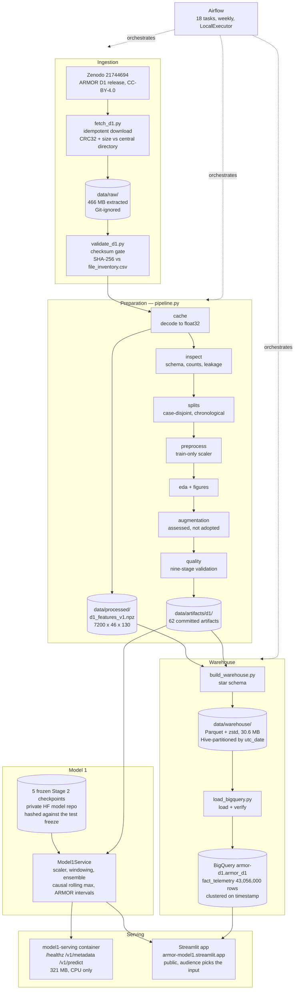
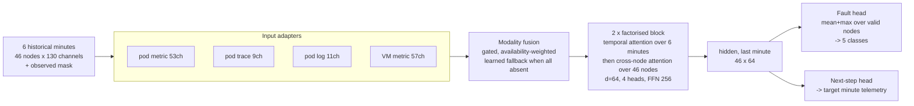
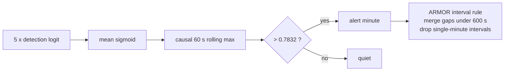

# ARMOR system architecture

What runs, where it runs, and how data moves between the pieces. Diagrams are
Mermaid, which GitHub renders in place, so they stay editable rather than
becoming a screenshot nobody can update.

Everything below is built and running unless a box says otherwise.

## 1. Data flow, source to prediction

The dotted edges are orchestration, not data. Airflow runs the same committed
scripts a developer runs by hand, so the DAG and a manual run cannot drift.

## 2. Where each piece runs

| Component | Runs on | Environment | State |
|---|---|---|---|
| Ingestion and preparation | Airflow, Docker, local | Python 3.12, numpy 2.5.3, pandas 3.0.6, scipy 1.18.1, matplotlib 3.11.2 | Built |
| Orchestration | Airflow 2.10.5, LocalExecutor, Postgres 16 | Docker Compose, repo mounted read-only | Built |
| Lakehouse | Local disk, Parquet + zstd | pyarrow 23.0.0 | Built |
| Warehouse | BigQuery sandbox, US | free tier, no billing account | Built |
| Model 1 training | Apple M4, CPU only, 1 torch thread | Python 3.14.4, torch 2.14.0 | Done, frozen |
| Inference service | Docker, CPU only | Python 3.14-slim, torch 2.14.0+cpu | Built |
| Prototype UI | Streamlit Community Cloud | Python 3.14, torch 2.14.0+cpu | Deployed |
| Checkpoint storage | Private Hugging Face model repo | pulled at start-up, hash-checked | Built |
| Models 2, 3, 4 | — | — | 298B |

The training environment is Python 3.14 and the Airflow image is Python 3.12,
the newest Airflow 2.10.5 supports. That gap is real: it is why regenerated
artifacts compare by content rather than by bytes.

## 3. Model 1 internals

Five frozen checkpoints voting. Each is the same architecture, trained from a
different seed.

Each adapter takes the masked values **and** the mask, so its input width is
twice its channel count. Unavailable entries are zeroed with `torch.where`
before any arithmetic, so a NaN in an unobserved slot cannot reach a weight.

Detection, on top of the five models:

The threshold is the empirical 90th percentile of rolled calibration scores,
fixed once on the calibration split. It is not retuned per run; the serving
metadata publishes it so a caller can check.

## 4. What the numbers are

| | Ours | ARMOR published |
|---|---|---|
| Detection F1 | 0.733 ± 0.052 | 0.9608 |
| Fault type, weighted F1 | 0.827 ± 0.039 | 0.938 |
| Fault type, macro F1 | 0.721 ± 0.055 | — |

The gap is reported rather than tuned away. Training consumed **14.01
CPU-hours** across 20 recorded runs on an Apple M4, CPU only, one torch thread,
deterministic algorithms on.

## 5. Trust boundaries

Three places where something could silently become wrong, and what stops it.

| Boundary | Risk | Control |
|---|---|---|
| Zenodo to disk | a truncated or altered release | CRC32 and size at fetch, SHA-256 against the committed inventory at verify, and a negative control that corrupts a scratch copy and asserts the gate rejects it |
| Pipeline to warehouse | a load that reports success but drops rows | row counts per table and per partition, split totals derived independently from `dim_split`, and a value checksum; any mismatch exits non-zero |
| Checkpoints to inference | serving a different model than was evaluated | every checkpoint hashed against `evidence_test_freeze.json` at start-up; the service refuses to run on a mismatch and publishes the hashes over `/v1/metadata` |

The repository is mounted read-only in Airflow. An earlier version mounted it
read-write and a scheduled run overwrote the team's reviewed artifacts, which is
why the DAG now regenerates into a disposable workspace and diffs the result
against the read-only original.
